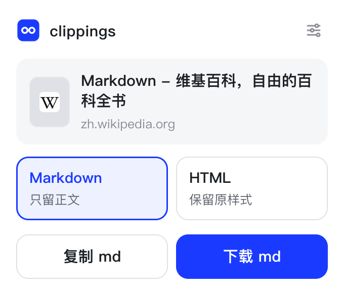
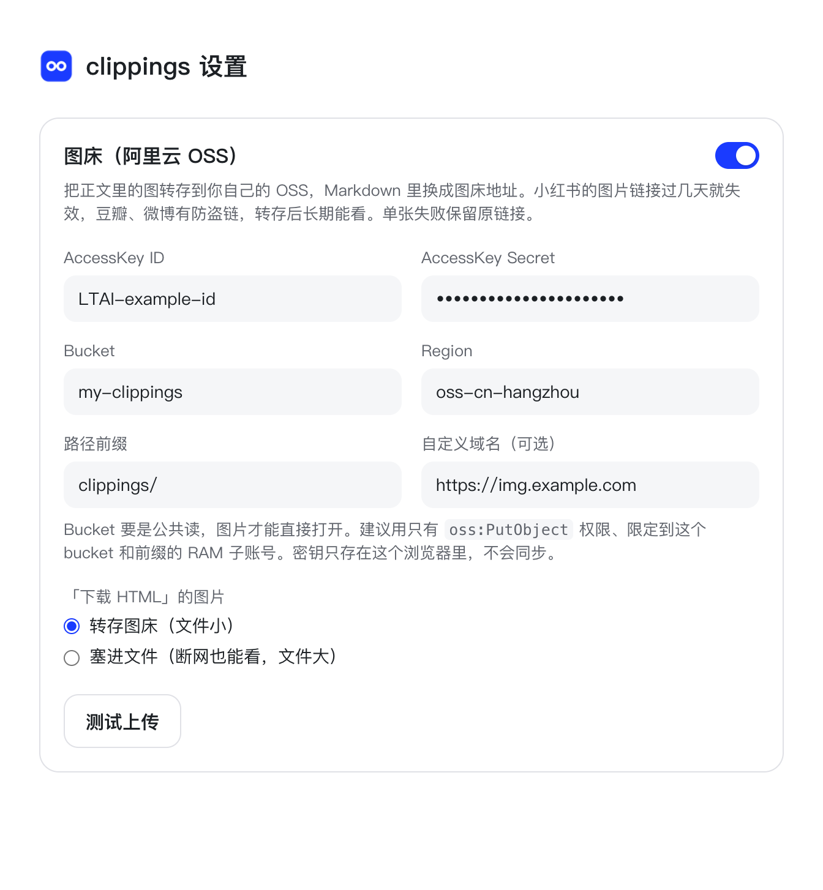

# clippings

一个浏览器扩展，把正在看的网页存下来：

- **复制 md / 下载 md**：只留正文，转成 Markdown，标题、作者、发布日期写在开头的 front-matter 里
- **下载 HTML**：整页存成一个能单独打开的 HTML 文件，保留原站样式，去掉广告和脚本。多图轮播存下来照样能左右翻，图片塞进文件里，断网、原帖删了也照样能看

小红书、微博、公众号、X、知识星球、GitHub Gist、豆瓣有专门的站点规则，其他文章页用通用规则。



A browser extension that saves the page you're reading as **Markdown** (main content only; copy or download) or as a **single-file HTML** that keeps the site's own styles, with ads and scripts removed, image carousels still working and images embedded, so it opens offline.

## 安装

还没上架商店，先手动装：

1. 到 [Releases](https://github.com/seyeeL/clippings/releases/latest) 下载最新的 `clippings-<版本号>.zip`，解压到一个固定的地方（比如「文档」里）。之后这个文件夹别删也别挪，删了扩展就没了
2. Chrome / Edge 打开 `chrome://extensions`，打开右上角「开发者模式」
3. 点「加载已解压的扩展程序」，选解压出来的文件夹（里面直接就是 `manifest.json` 的那一层）

更新：没有自动更新。下载新版，解压覆盖原来的文件夹，在 `chrome://extensions` 里点 clippings 的刷新按钮。设置不会丢。

## 用法

点工具栏上的 clippings 图标，选格式：

| 格式 | 按钮 | 得到什么 |
|------|------|---------|
| Markdown | 复制 md、下载 md | `<标题>-<日期>.md`，只有正文 |
| HTML | 下载 HTML | `<标题>-<日期>.html`，整页带样式 |

### Markdown

存下来的 md 长这样：

```markdown
---
title: "文章标题"
url: https://example.com/article
author: "某某"
site: "某某网站"
published: 2026-08-01
clipped: 2026-11-11
---

# 文章标题

正文段落，**行内标记**、[链接](https://example.com)、列表、代码块、表格都会保留。
```

取不到的字段（作者、发布日期）就不写，不编。正文自己以一级标题开头的，不再补一个标题。

### HTML

- 长得和原页面一样，只去掉广告、脚本和看不见的元素
- 多图能翻：小红书这类轮播换成纯 CSS 的，左右箭头、页码、圆点都能点，文件里不带脚本
- 没配图床时图片塞进文件，断网也能看，代价是文件大（小红书一条带几百条评论的笔记 7～8 MB）。配了图床默认转存图床，也可以在设置页改回塞进文件，见下文
- 图多的页面要几十秒，这期间别关弹窗，关了就白跑

### 文件名

`<标题>-<今天>.md` / `.html`。去掉文件名里不能用的字符和 `@`（微博的标题是「@作者的微博：…」），最长 60 字。标题里已经带日期的（比如「2026-10-27 - WakaTime」）不再加今天，免得两个日期分不清。

### 评论

「同时存评论」只在支持的站点上出现：

- X、豆瓣：把页面上已经加载出来的回复一起收进来（Markdown 和 HTML 都有）
- 小红书（只有 HTML）：存之前在页面上往下翻评论、点开楼中楼，最多两分钟。小红书有风控，翻得太快会弹验证，所以每一步都隔几秒，碰到验证框立刻停，存下已经翻出来的那些。这期间别关弹窗。不开这个开关时，HTML 里照样有页面上已经显示的评论

## 图床（可选）

Markdown 里的图默认还是原站链接，可小红书的图片地址过几天就失效，豆瓣、微博有防盗链，换个地方就打不开。想长期留着，可以配一个自己的阿里云 OSS 当图床：弹窗右上角的设置 → 打开「图床」，填 AccessKey、Bucket、Region。改了自动保存。



- 复制 md、下载 md：正文里的图传到 OSS，链接换成图床地址
- 下载 HTML：图片可以转存图床（文件小），也可以塞进文件（断网也能看，文件大），在设置页选。HTML 没有「留原链接」这个选项，因为原链接过几天就打不开
- 单张图传失败就保留原链接，不影响这次保存；单张超过 10 MB 的不传
- 对象名按图片内容哈希起：`<路径前缀><年-月>/<哈希>.<后缀>`。同一张图存几次都是同一个文件，也不会因为原站文件名撞车互相覆盖

### 准备 OSS

1. 建一个 bucket，读写权限选「公共读」，不然图片打不开。不用配 CORS：扩展拿到权限后发请求不受 CORS 限制
2. 建一个 RAM 子账号，只给它往这个 bucket 的这个前缀里传文件的权限，别用主账号的 AccessKey。权限策略可以这样写（把 `my-clippings` 和 `clippings/` 换成你自己的 bucket 和路径前缀）：

   ```json
   {
     "Version": "1",
     "Statement": [{
       "Effect": "Allow",
       "Action": ["oss:PutObject"],
       "Resource": ["acs:oss:*:*:my-clippings/clippings/*"]
     }]
   }
   ```

3. 把子账号的 AccessKey ID、Secret，bucket 名，region（如 `oss-cn-hangzhou`）填进设置页，点「测试上传」

AccessKey 只存在这个浏览器里（`chrome.storage.local`），不随账号同步，也不会发给 OSS 以外的任何地方。

### 传不上去怎么查

设置页的「测试上传」会传一张 1×1 的 PNG，配置不全、OSS 不收，都会直接说出来。OSS 的错误码原样带出，常见的几个：

| 错误码 | 意思 |
|--------|------|
| `InvalidAccessKeyId` | AccessKey ID 填错了，或者已经删了 |
| `SignatureDoesNotMatch` | Secret 不对，或者 bucket / region 和密钥不属于同一个账号 |
| `AccessDenied` | 密钥有效但没有写权限：给子账号加 `oss:PutObject`，确认授权的路径覆盖了填的前缀 |
| `NoSuchBucket` | bucket 不存在，或者 region 填错了（两个必须对得上） |
| `RequestTimeTooSkewed` | 电脑时钟和 OSS 差太多，校准一下系统时间 |

测试能传、存文章时图片还是原链接：在弹窗上右键「检查」，Console 里有每张图失败的原因。

## 权限

| 权限 | 用来做什么 |
|------|-----------|
| `activeTab`、`scripting` | 你点图标时读取当前页的正文 |
| `storage` | 记住图床设置 |
| 读取所有网站的数据（可选，第一次点「下载 HTML」或打开图床时询问） | 抓这一页的样式表和图片，传图到你的 OSS |
| `declarativeNetRequestWithHostAccess` | 抓图片时带上原页面的 Referer（豆瓣、微博的图片不带就拿不到），存完立刻撤掉 |

扩展不收集任何数据，也没有服务器：所有处理都在你的浏览器里完成，只会向当前网页自己的站点请求样式表和图片，配了图床的话再传到你自己的 OSS。

## 已知边界

- 浏览器不让扩展读的页面存不了：`chrome://` 开头的页面、扩展商店、浏览器自带的 PDF 阅读器
- 没有专门规则的网站按页面结构猜正文，论坛、瀑布流这类页面可能漏掉或多出一些。细节见 [web-extract 的已知边界](https://github.com/seyeeL/web-extract#已知边界)
- 评论只存页面上已经加载出来的（小红书除外，见上文）。想多存就先在页面上往下滚
- 图床只支持阿里云 OSS。腾讯云 COS、七牛这些签名方式不一样，没做

## 开发

正文提取、Markdown 转换、带样式 HTML 的拼装来自 [web-extract](https://github.com/seyeeL/web-extract)，`lib/` 下是它 `src/` 里几个文件的副本。别直接改副本：改 web-extract，再同步过来：

```bash
node scripts/sync-web-extract.mjs ../web-extract   # 同步 lib/，记下来源 commit
npm test                                           # 单元测试，顺便检查 lib/ 没被直接改过、打包清单没漏目录
npm run pack                                       # 打包成 clippings.zip，发 Release、上传商店都用它
```

没有构建步骤，改完在 `chrome://extensions` 里点刷新就生效。

## 许可

[PolyForm Noncommercial 1.0.0](LICENSE)，和 web-extract 一样：个人和非商业用途随便用。
